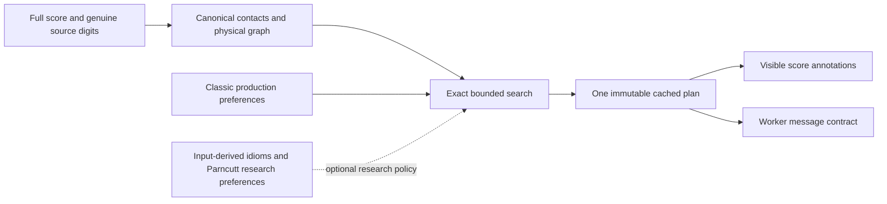

# Unified piano planning

The application now uses one complete timed-score plan for ordinary and instrument-edition piano fingerings. The default objective is still classic. The composed Parncutt policy is implemented and browser-worker tested, but it failed the automatic family regression gate and is not activated in the product. Human review is not required for that decision.

## Composition and ownership



- `piano-score-fingering.ts` owns notation conversion, full-source hand ownership and genuine printed-digit anchors. Printed digits outrank explicitly supplied anchors. Hidden notation retains its constraints; tied continuations do not get new attack digits.
- `piano-phrase-fingering.ts` owns canonical ties/unisons, occupied fingers, geometry, feasibility, deterministic exact search and explicit unsupported diagnostics. Its optional two-attack objective uses the existing bounded memory search. Reported physical costs retain their meaning; preference adjustments are not relabeled as movement costs.
- `research/chirality/unified.ts` replaces overlapping melodic preferences rather than adding competing copies. Classic spatial strain, repeats, held-key constraints and substitutions remain. For unambiguous contiguous streams, Parncutt owns color, weak-digit, pair and triple preferences; classic movement is scaled to 0.1 and classic crossing preference removed there. Grips and ambiguous contacts retain classic preferences.
- Closed positions and chromatic runs are recognized from pitches, timing and voice/phrase boundaries. No song names, reference labels, exercise-family tags or prediction agreement enter recognition. Protected passages retain the classic objective, not fixed digits; a neighboring unprotected passage can still affect the optimum.
- `piano-planning-service.ts` provides the shared synchronous default cache and an asynchronous backend interface. The async service serializes work, coalesces queued requests and rejects stale results. Cache keys include musical identity, pitch, timing, holds, ties, anchors, voice/phrase context, profile and policy version; presentation and playback cursor are excluded. Results and inputs are cloned. Invalidation prevents an older job from repopulating the cache.
- `piano-planning-worker.ts` implements the classic worker. `research/chirality/unified-worker.ts` implements the optional research worker with caller-supplied weights. Worker IDs, policy versions, failures and closure are checked. Consumers that change backend configuration must use a matching version/model fingerprint. The app renderer currently uses the cached synchronous classic entry; automatic worker activation is not part of this change.
- `beginner-score.ts` routes generated piano editions into the same planner and larger annotation style. Legacy callback tables are not promoted into authored anchors. The old text route requires an explicit authored-layer argument and has no product caller. Guitar routing is unchanged. Collision placement moves a generated digit and its shift ring as one object.

Historical sequence/neural/structured experiments remain reproducible research. They do not vote on the product output or add a cascade of whole-hand replacements. No published weights, external runtime, Python or research AGPL module is imported into the product path. The Chirality-derived policy retains the existing research licensing boundary.

## Frozen evaluation and decision

The eighteen available Mutopia Burgmüller Op.100 sources were reserved and committed before policy implementation. V1 was checked only on consumed development cases. Its scale/five-finger regressions motivated an input-only local closed-position recognizer; V2 was frozen before one development replay and fresh evaluation. No coefficients changed, no training ran, and fresh scores were not used to retune the policy. A subsequent implementation replay reproduced every aggregate count and gate. This is new policy-validation material; overlap with the upstream model's PIG training cannot be certified.

| Evidence | Classic printed-digit matches | Unified V2 |
| --- | ---: | ---: |
| Consumed printed references | 5,403 / 7,947 (68.0%) | 5,644 / 7,947 (71.0%) |
| Fresh Burgmüller | 355 / 1,012 (35.1%) | 380 / 1,012 (37.5%) |
| Consumed completed references, secondary evidence | 3,355 / 8,757 (38.3%) | 5,171 / 8,757 (59.0%) |
| Printed arpeggio family | 164 / 567 | 339 / 567 |
| Printed five-finger family | 2,932 / 3,439 | 2,927 / 3,439 |

Scales, chromatic and repertoire totals are unchanged; technical passages improve from 344 to 415 / 1,070. Printed complete-case matches increase from 13 to 14, complete hands from 36 to 48, and adjacent printed transition matches from 2,747 to 2,906. Fresh complete hands remain one, with adjacent matches increasing from 35 to 48. Both methods cover 716 fresh printed digits and return 26 complete fresh hands with zero detected physical conflicts. Five ornament/cross-staff pieces remain unsupported for both methods and stay in the denominators. A fingering mismatch is not automatically a musical error, but the frozen nonregression gate still applies.

**Decision: retain classic as default.** V2 loses five five-finger digits, one fully matching exercise and two fully matching hands in that family. Aggregate improvement does not override that gate. The new compositional mechanism and common runtime are complete; activating its research scoring policy requires a later policy iteration and a new untouched validation reservation. No human-review step is imposed.

Numeric evidence: [V2 results](piano-unified-results.json), [retained V1 development results](piano-unified-v1-development.json), and the [fresh reservation](../packages/music-practice/test-fixtures/external/mutopia-burgmuller/reservation.json).

## Reproduce and test

Use Node 24. Published coefficients remain an explicitly supplied ignored artifact.

```sh
python3 packages/music-practice/scripts/piano-neural/import-burgmuller.py work/burgmuller-import
PIANO_PYTHON=/absolute/path/to/python-with-mido
"$PIANO_PYTHON" packages/music-practice/scripts/piano-neural/verify-burgmuller-midi.py work/burgmuller-import
npx tsx packages/music-practice/scripts/piano-neural/unified-evaluate.ts \
  packages/music-practice/test-fixtures/external/mutopia-burgmuller/corpus.json \
  work/chirality/parncutt.json work/unified-new-report.json
npm run ci -- --base origin/main
```

The fresh importer delegates relative pitch and rhythm to LilyPond 2.26.0, uses a written repeat pass (each printed alternative once), separates labels from prediction inputs and retains ambiguous digit flags. Its conservative physical staccato hold is half the notation duration, matching the score adapter. An independent LilyPond MIDI traversal verifies attack pitch/onset for all thirteen notation-supported pieces; this does not independently certify finger labels or physical release duration. Sources, rational event traces, corpus and MIDI verification are retained with the reservation.

The fresh comparison uses a common 120 BPM planning profile for both methods, rather than each source's performance tempo. This controls that variable; the results do not establish quality across tempo changes. Product planning continues to use the source score's normalized tempo.

CI's existing shared/music glob owns `piano-unified`, `piano-planning-service`, `piano-edition-planning`, `piano-fingering-voices` and importer units. The existing required `piano-fingering.browser.ts` owns real classic/research workers, stale requests/cache use, common rendering, explicit authored layers and hidden-source constraints in Chromium/WebKit. Every registered piano edition has a Node safety/identity contract; its existing `*-editions.browser.ts` remains the Nightly layout owner. The exhaustive corpus comparison stays manual/Nightly evidence and is not appended to the bounded CI lane.

The initial new worker fixture failed because a module worker was loaded from opaque `about:blank`; its retained failure is `work/piano-composition/browser.log`. The corrected fixture intercepts a reserved test origin locally and opens no port. The first expanded edition run exposed touching generated digits (`work/ci-results/1795722716232-f2fb9592`); collision placement was corrected in product code, preserving the assertions.

Two later edition aliases were mistakenly started concurrently outside the local coordinator, causing duplicate preview ports (`1795722902007-faffd740` and `1795722902007-00e213e3`). The retained failures show preview exits/connection refusal; those partial runs are not suite passes. Subsequent edition validation uses one coordinator with shared resource locks. No assertion retry, timeout increase or test exclusion was introduced.
