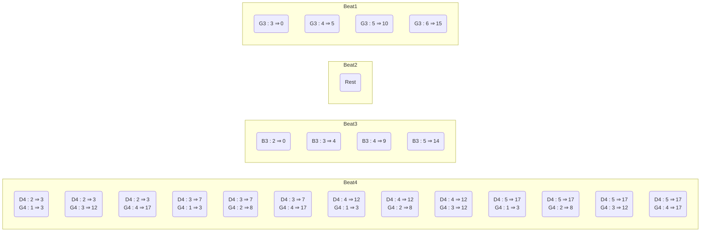

## Pathfinding Algorithm Visualization

The pathfinding calculation is initiated by `generate_arrangements()` (which calls `create_arrangements()` internally).

Let's look at an example with a standard guitar where we want to find the optimal arrangement to play a G3, then a rest, then a B3, then a D4 and G4 simultaneously. The pitch input for this example could look like this:

```text
G3

B3
D4G4
```

### Pitch Fingerings

The different fingerings are then calculated for each pitch. For example, a G3 can be played on string 3 at fret 0, or string 4 at fret 5, and so on:

#### Beat 1 pitch fingerings

| Representation | String | Fret |
| :------------- | :----: | :--: |
| G3 : 3 ⇒ 0     |   3    |  0   |
| G3 : 4 ⇒ 5     |   4    |  5   |
| G3 : 5 ⇒ 10    |   5    |  10  |
| G3 : 6 ⇒ 15    |   6    |  15  |

#### _Beat 2 is a rest and therefore has no fingerings._

#### Beat 3 pitch fingerings

| Representation | String | Fret |
| :------------- | :----: | :--: |
| B3 : 2 ⇒ 0     |   2    |  0   |
| B3 : 3 ⇒ 4     |   3    |  4   |
| B3 : 4 ⇒ 9     |   4    |  9   |
| B3 : 5 ⇒ 14    |   5    |  14  |

#### Beat 4 pitch fingerings

| Representation | String | Fret |     | Representation | String | Fret |
| :------------- | :----: | :--: | --- | :------------- | :----: | :--: |
| D4 : 2 ⇒ 3     |   2    |  3   |     | G4 : 1 ⇒ 3     |   1    |  3   |
| D4 : 3 ⇒ 7     |   3    |  7   |     | G4 : 2 ⇒ 8     |   2    |  8   |
| D4 : 4 ⇒ 12    |   4    |  12  |     | G4 : 3 ⇒ 12    |   3    |  12  |
| D4 : 5 ⇒ 17    |   5    |  17  |     | G4 : 4 ⇒ 17    |   4    |  17  |

### Fingering combinations for each beat

For beat 1 and beat 3, the fingering combinations are identical to the pitch fingerings since those beats only play one pitch each. For beat 4, we calculate the [cartesian product](https://en.wikipedia.org/wiki/Cartesian_product) of the pitch fingerings to consider all of the fingerings combinations.

#### Beat 4 fingering combinations

| D4 Fingering    |     | G4 Fingering    |
| :-------------- | --- | :-------------- |
| D4 : 2 ⇒ 3      |     | G4 : 1 ⇒ 3      |
| ~~D4 : 2 ⇒ 3~~  |     | ~~G4 : 2 ⇒ 8~~  |
| D4 : 2 ⇒ 3      |     | G4 : 3 ⇒ 12     |
| D4 : 2 ⇒ 3      |     | G4 : 4 ⇒ 17     |
| D4 : 3 ⇒ 7      |     | G4 : 1 ⇒ 3      |
| D4 : 3 ⇒ 7      |     | G4 : 2 ⇒ 8      |
| ~~D4 : 3 ⇒ 7~~  |     | ~~G4 : 3 ⇒ 12~~ |
| D4 : 3 ⇒ 7      |     | G4 : 4 ⇒ 17     |
| D4 : 4 ⇒ 12     |     | G4 : 1 ⇒ 3      |
| D4 : 4 ⇒ 12     |     | G4 : 2 ⇒ 8      |
| D4 : 4 ⇒ 12     |     | G4 : 3 ⇒ 12     |
| ~~D4 : 4 ⇒ 12~~ |     | ~~G4 : 4 ⇒ 17~~ |
| D4 : 5 ⇒ 17     |     | G4 : 1 ⇒ 3      |
| D4 : 5 ⇒ 17     |     | G4 : 2 ⇒ 8      |
| D4 : 5 ⇒ 17     |     | G4 : 3 ⇒ 12     |
| D4 : 5 ⇒ 17     |     | G4 : 4 ⇒ 17     |

> Note: `D4 : 2 ⇒ 3` with `G4 : 1 ⇒ 3` is valid; while `D4 : 2 ⇒ 3` with `G4 : 2 ⇒ 8` is invalid since multiple frets cannot be played on the same string.

### Pathfinding nodes

To calculate the optimal set of fingering combinations of each beat, we construct a node for each fingering combination. The node contains underlying data that informs the calculation of the difficulty of progressing from one fingering combination to another including

- the average non-zero fret value
- the non-zero fret span

Additionally, each node must be unique so the beat index is included in the underlying data of the node.



